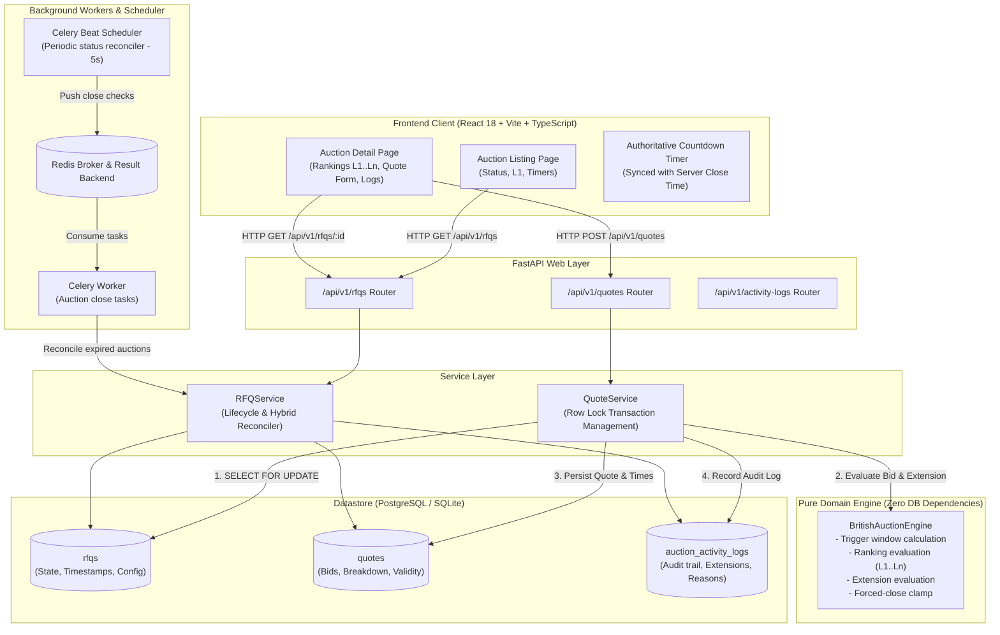

# British Auction in RFQ System

A full-stack Request for Quotation (RFQ) platform implementing **British Auction** mechanics with autonomous anti-sniping dynamic bid extensions, hard forced-close deadlines, and supplier ranking leaderboards.

This project implements the reverse-auction interpretation specified by the assignment for freight procurement: buyers invite logistics suppliers to submit quotes, suppliers compete by progressively lowering prices, and qualifying activity near the deadline dynamically extends the auction to ensure fair market price discovery.

---

## Table of Contents
1. [Overview](#1-overview)
2. [Key Features](#2-key-features)
3. [Demo Flow](#3-demo-flow)
4. [System Architecture](#4-system-architecture)
5. [Tech Stack](#5-tech-stack)
6. [Quick Start](#6-quick-start)
   - [Local Development](#option-a-running-locally-fastest)
   - [Docker Compose](#option-b-running-with-docker-compose-full-stack)
7. [Running Tests](#7-running-tests)
8. [API Reference](#8-api-reference)
9. [Database & Migrations](#9-database--migrations)
10. [Documentation Index](#10-documentation-index)
11. [Screenshots](#11-screenshots)

---

## 1. Overview

In freight and logistics procurement, traditional fixed-deadline RFQs suffer from last-second bid sniping, where carriers withhold their competitive prices until the final moments. The British Auction mechanism counters this by:
- Operating as an open reverse auction (lower total price receives higher rank: $L1, L2, L3, \dots$).
- Automatically extending the closing deadline by $Y$ minutes when qualifying bidding activity occurs within the final $X$ minutes (trigger window).
- Enforcing a hard `forced_bid_close_time` ceiling beyond which no further extensions are granted and bidding terminates.

---

## 2. Key Features

- **British Reverse Auction Mechanics**: Suppliers submit competing quotes; lowest total price holds $L1$ rank. Subsequent bids from the same carrier must strictly improve (lower) their previous best price.
- **Configurable Extension Triggers**:
  - `BID_RECEIVED`: Any valid quote submitted within the last $X$ minutes extends the auction by $Y$ minutes.
  - `RANK_CHANGE`: Any shift in supplier ranking ($L1, L2, \dots$) within the last $X$ minutes extends the auction.
  - `L1_CHANGE`: Only quotes displacing the lowest bidder ($L1$) within the last $X$ minutes extend the auction.
- **Dynamic Moving Trigger Window**: As the auction extends forward in time, the $X$-minute trigger window dynamically recalculates relative to the *current active close time*, not the original close time.
- **Forced Close Hard Ceiling**: Clamps extensions so that $new\_close = \min(current\_close + Y, forced\_close)$. Bids submitted at or after the close boundary are rejected.
- **Pessimistic Concurrency Control**: Uses PostgreSQL row-level locking (`SELECT ... FOR UPDATE`) to serialize simultaneous quotes on the same RFQ, preventing lost updates, race conditions, or duplicate extension increments.
- **Pure Domain Engine**: The core evaluation logic (`BritishAuctionEngine`) is decoupled from database and HTTP frameworks, enabling isolated, deterministic unit testing of boundary conditions.
- **Hybrid Status Reconciler**: Periodic Celery Beat worker ticks every 5 seconds to expire auctions, with a passive fallback check on API queries to guarantee zero stale states.
- **Audit & Activity Log**: Chronological log capturing quote submissions, time extensions, explicit reasons, and lifecycle state changes.
- **Authoritative Presentation**: The React client acts as a pure presentation layer displaying authoritative server state, countdown clocks, and leaderboards.

---

## 3. Demo Flow

The end-to-end lifecycle of an auction follows this sequence:

```text
1. RFQ Creation
   └── Buyer inputs Reference ID, Shipment Title, Start Time, Initial Close Time,
       Forced Close Time (> Close Time), Pickup Date, and British Auction settings (X, Y, Trigger Rule).

2. Bidding Opens
   └── Status transitions to ACTIVE. Suppliers submit quotes consisting of Freight,
       Origin, and Destination charges, committed transit days, and quote validity.

3. Price Calculation & Ranking
   └── Total Price = Freight + Origin + Destination.
       Lowest total price is assigned L1 rank. Ties resolve in favor of earlier submission timestamp.

4. Bidding Outside Trigger Window
   └── Quotes submitted before (Close Time - X minutes) update the leaderboard
       without altering the auction closing time.

5. Anti-Sniping Trigger Inside Window
   └── A quote meeting the trigger rule arrives in [Close Time - X, Close Time).
       Close time is extended: new_close = min(current_close + Y, forced_close).
       An AUCTION_EXTENDED event is recorded in the activity log with the exact reason.

6. Repeated Extensions & Moving Window
   └── The trigger window moves forward with the new close time.
       Successive qualifying bids continue extending until candidate close reaches forced close.

7. Forced Close Ceiling Reached
   └── If candidate extension crosses forced_bid_close_time, it is clamped to forced close (is_capped = True).
       Once at forced close, no further extensions can occur.

8. Auction Closure
   └── When the active close time elapses, Celery Beat reconciles status to CLOSED (or FORCE_CLOSED).
       Any subsequent bids are rejected with HTTP 400.
```

---

## 4. System Architecture



For detailed component interaction, transaction boundaries, and state machines, see [docs/architecture-hld.md](docs/architecture-hld.md).

---

## 5. Tech Stack

- **Backend**: Python 3.11+, FastAPI, Pydantic v2, SQLAlchemy 2.0, Alembic
- **Database**: PostgreSQL 16 (containerized/production) / SQLite with WAL mode (local unit testing)
- **Background Tasks**: Celery 5.3+, Redis 7
- **Frontend**: React 18, TypeScript, Vite, TailwindCSS, Lucide Icons
- **Testing**: Pytest, Pytest-Asyncio, HTTPX

---

## 6. Quick Start

### Option A: Running Locally (Fastest)

#### 1. Backend Setup
```bash
# Clone and enter directory
cd british-auction-rfq-system

# Create and activate virtual environment
python3 -m venv venv
source venv/bin/activate

# Install dependencies
pip install -r backend/requirements.txt

# Run database migrations
cd backend
alembic upgrade head

# Start FastAPI server
PYTHONPATH=. uvicorn app.main:app --host 0.0.0.0 --port 8000 --reload
```
- API Base: `http://localhost:8000`
- Swagger UI Documentation: `http://localhost:8000/docs`

#### 2. Frontend Setup
```bash
# In a new terminal tab
cd frontend

# Install dependencies
npm install

# Start Vite dev server
npm run dev
```
Open `http://localhost:5173` in your browser.

---

### Option B: Running with Docker Compose (Full Stack)

To run the complete containerized environment (PostgreSQL 16, Redis 7, FastAPI backend, Celery worker, Celery beat, and Nginx frontend):

```bash
docker compose up --build -d
```

- **Frontend Application**: `http://localhost:3000`
- **Backend API**: `http://localhost:8000`
- **Interactive API Docs**: `http://localhost:8000/docs`

To view container status:
```bash
docker compose ps
```

---

## 7. Running Tests

The test suite covers unit tests for the pure auction engine, boundary conditions, concurrent bid ingestion, API endpoints, background tasks, and full end-to-end auction lifecycles:

```bash
source venv/bin/activate
cd backend
PYTHONPATH=. pytest tests/ -v
```

### Test Suite Summary (21 Tests, 100% Passing):
- `test_auction_engine.py` (11 tests):
  - Normal extension inside window
  - Quote outside trigger window
  - Boundary check at exact close timestamp
  - Bid rejection after forced close
  - Extension clamped strictly to forced close
  - Successive multiple extensions with ceiling clamping
  - `RANK_CHANGE` trigger mode
  - `L1_CHANGE` trigger mode
  - Uncompetitive higher quote rejection for existing carrier
  - Quote before auction start rejection
  - Timestamp tie-breaking
- `test_concurrency.py`: Simultaneous quotes from 4 threads serialized with row-level locks.
- `test_e2e_lifecycle.py`: Complete lifecycle test with moving trigger window verification.
- `test_quote_api.py` (3 tests): Quote submissions, charges sum validation, and quote validity $\ge$ bid close validation.
- `test_rfq_api.py` (4 tests): RFQ creation, forced close $>$ bid close validation, duplicate reference rejection, and detail queries.
- `test_tasks.py`: Celery background reconciliation for expired auctions.

---

## 8. API Reference

| Method | Endpoint | Description |
|---|---|---|
| `GET` | `/health` | Health check verifying database and Redis connectivity |
| `POST` | `/api/v1/rfqs` | Create an RFQ with British Auction parameters |
| `GET` | `/api/v1/rfqs` | List all RFQs with current status and lowest bid |
| `GET` | `/api/v1/rfqs/{id}` | Get RFQ details, supplier leaderboard, quotes, and audit logs |
| `POST` | `/api/v1/rfqs/{id}/quotes` | Submit a quote (evaluates trigger window, rank, and extensions) |
| `GET` | `/api/v1/rfqs/{id}/logs` | Fetch chronological activity logs for an RFQ |

---

## 9. Database & Migrations

The database schema is managed with SQLAlchemy 2.0 declarative models and versioned with Alembic.

### Core Tables:
1. **`rfqs`**: Stores reference IDs, status (`UPCOMING`, `ACTIVE`, `CLOSED`, `FORCE_CLOSED`), start/close times, `forced_bid_close_time`, and auction parameters ($X$, $Y$, trigger type).
   - *Constraints*: `chk_forced_after_close`, `chk_close_after_start`, `chk_positive_window`, `chk_positive_extension`.
2. **`quotes`**: Stores supplier quotes with `Numeric(12, 2)` monetary columns for freight, origin, and destination charges, transit days, validity timestamp, and rank at submission.
   - *Indexes*: Composite index `(rfq_id, total_price ASC, submitted_at ASC)` for fast reverse-auction ranking.
3. **`auction_activity_logs`**: Immutable audit log capturing quote submissions, extension events, reasons, and state transitions.

### Migrations:
```bash
cd backend
alembic upgrade head
```

### Data Persistence:
In Docker Compose, PostgreSQL stores all database files in a named volume (`pgdata`), mounted to `/var/lib/postgresql/data`. Data survives container restarts and complete compose down/up cycles.

For detailed schema definitions, data dictionaries, and constraint details, see [docs/schema-design.md](docs/schema-design.md).

---

## 10. Documentation Index

- [High-Level Architecture (HLD)](docs/architecture-hld.md): System architecture, Mermaid flowcharts, and auction state machine.
- [Database Schema Design](docs/schema-design.md): Entity relationship diagram, data dictionaries, indexes, and constraints.
- [Architectural Decision Record (ADR)](docs/decisions.md): System design rationale, alternatives considered, and engineering trade-offs.
- [Debugging Notes & Incident Log](docs/debugging-notes.md): Log of edge cases encountered and verified fixes.
- [Requirements Analysis](docs/requirements-analysis.md): Business rules, parameters, and reverse-auction mechanics.
- [Simulated Code Review](docs/simulated-code-review.md): Senior engineer review of design, concurrency, security, and edge cases.
- [Screenshots Guide](docs/screenshots/README.md): Visual walkthrough structure and key views.

---

## 11. Screenshots

Visual representations of the application views can be referenced in [docs/screenshots/README.md](docs/screenshots/README.md):
- **Auction Listing Page**: Overview of active, upcoming, and closed auctions with live lowest bids.
- **Create RFQ Modal**: Parameter configuration ($X$ trigger window, $Y$ extension duration, trigger rules).
- **Auction Details & Live Clock**: Authoritative countdown clock, anti-sniping alert, and forced-close ceiling.
- **Supplier Ranking Leaderboard**: $L1, L2, \dots$ standings with quote history and user-controlled sorting toggle (`Lowest Price First` vs `Newest First`).
- **Activity Log & Audit Trail**: Chronological feed recording quotes, extensions, and exact reasons.
- **Interactive Swagger Docs**: OpenAPI interface at `http://localhost:8000/docs`.
