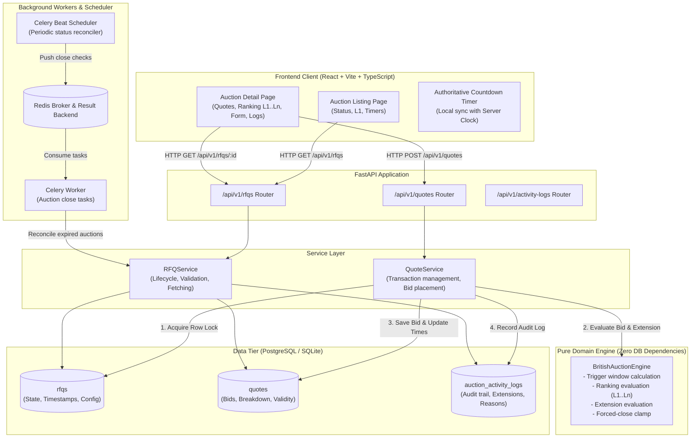
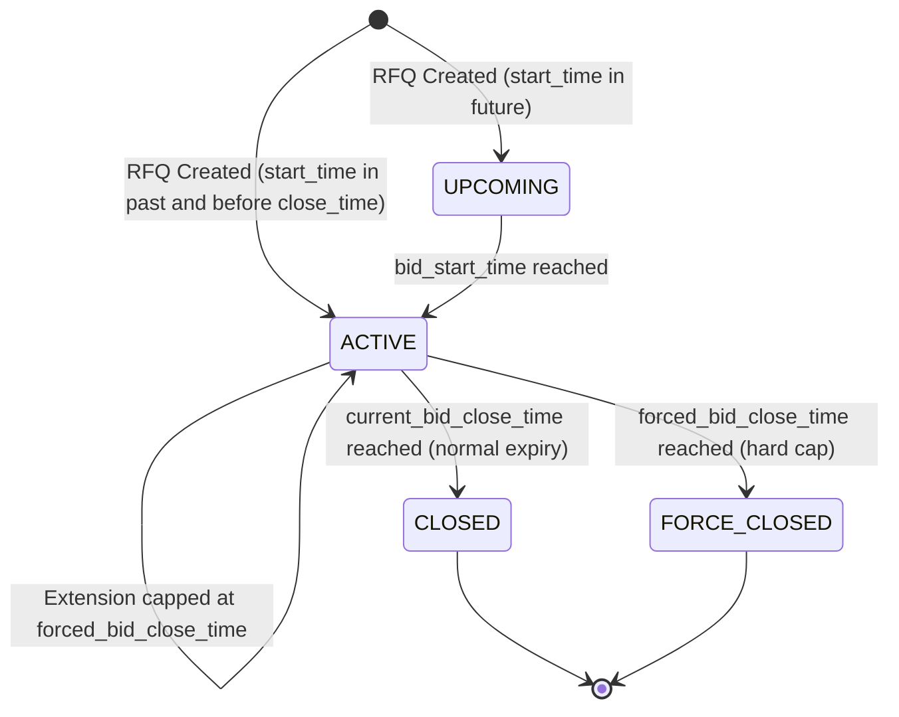

# High-Level Architecture Design (HLD)

## 1. System Overview
The British Auction RFQ System is an enterprise freight procurement platform. It enables buyers to post RFQs with British auction mechanics (reverse auction with dynamic anti-sniping extensions and a hard forced close time limit), and allows carriers to submit competing quotes.

---

## 2. Architecture Diagram

---

## 3. Component Breakdown

### 3.1 Frontend (React + Vite + TailwindCSS)
- **Role**: Pure presentation layer.
- **Responsibilities**:
  - Render RFQ listing with current status badge (`UPCOMING`, `ACTIVE`, `CLOSED`, `FORCE_CLOSED`), current lowest bid ($L1$), and close times.
  - Render RFQ details with interactive quote submission form, ranked leaderboard ($L1, L2, \dots$), breakdown of freight/origin/destination charges, and complete chronological activity log.
  - Render an accurate countdown timer derived strictly from server-provided `current_bid_close_time`.
  - Polling mechanism (every 3 seconds on active auction details) to display newly submitted bids and extensions without manual refresh.

### 3.2 FastAPI Web Layer
- **Role**: HTTP serialization, input validation, status codes, OpenAPI schema generation.
- **Routers**:
  - `POST /api/v1/rfqs`: Create an RFQ with British Auction parameters.
  - `GET /api/v1/rfqs`: List RFQs with current summary (status, lowest quote, close times).
  - `GET /api/v1/rfqs/{id}`: Detailed RFQ state including quote history, ranked suppliers, and activity logs.
  - `POST /api/v1/rfqs/{id}/quotes`: Submit a quote / bid.
  - `GET /api/v1/rfqs/{id}/logs`: Fetch activity and audit logs for an RFQ.

### 3.3 Service Layer
- **`RFQService`**: Coordinates RFQ creation, validation (e.g. `forced_bid_close_time > bid_close_time`), retrieving active views, and background closure reconciliation.
- **`QuoteService`**: Wraps quote submission in an atomic database transaction. Acquires pessimistic row-level lock on the RFQ, invokes `BritishAuctionEngine`, writes the quote, applies extensions, and writes activity log records.

### 3.4 British Auction Engine (`auction_engine.py`)
- **Role**: Pure domain logic. No ORM models, no SQL, no network calls. Takes data inputs and returns deterministic state transitions.
- **Inputs**:
  - `current_close_time`: `datetime`
  - `forced_close_time`: `datetime`
  - `trigger_window_minutes`: `int` ($X$)
  - `extension_duration_minutes`: `int` ($Y$)
  - `trigger_type`: Enum (`BID_RECEIVED`, `RANK_CHANGE`, `L1_CHANGE`)
  - `current_ranking`: Current list of ranked supplier prices
  - `new_bid`: Carrier and total price
  - `bid_timestamp`: `datetime`
- **Outputs**:
  - `is_valid`: Boolean (whether bid is acceptable)
  - `validation_error`: Optional string reason
  - `new_ranking`: Updated list of ranked suppliers
  - `rank_changed`: Boolean
  - `l1_changed`: Boolean
  - `should_extend`: Boolean
  - `new_close_time`: Updated `datetime`
  - `extension_reason`: Human-readable reason for audit log
  - `is_capped`: Boolean (whether extension hit forced close limit)

### 3.5 Celery & Redis
- **Role**: Periodic background reconciliation.
- **Worker**: Every 5 seconds, Celery Beat runs `reconcile_auction_statuses` task to check for active RFQs whose `current_bid_close_time` or `forced_bid_close_time` has elapsed and updates their status to `CLOSED` or `FORCE_CLOSED`.

---

## 4. Auction State Machine

