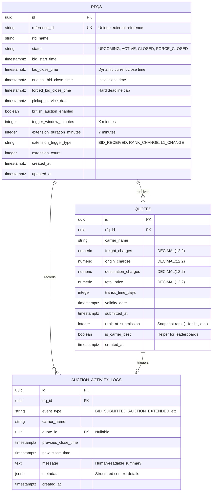

# Database Schema Design & Entity Relationships

## 1. Schema Overview & Relational Design

The database design adheres to 3NF normalization, uses strong typed constraints, ensures exact monetary precision, and includes composite indexes tailored for reverse-auction ranking queries and concurrency controls.

---

## 2. Entity-Relationship Diagram (ERD)



---

## 3. Data Dictionary & Table Definitions

### 3.1 `rfqs` Table
| Column | Type | Constraints | Description |
|---|---|---|---|
| `id` | `UUID` | Primary Key, default `uuid_generate_v4()` | Unique internal identifier |
| `reference_id` | `VARCHAR(64)` | Unique, Not Null, Indexed | External RFQ Code (e.g. `RFQ-2026-DEL-BOM`) |
| `rfq_name` | `VARCHAR(255)` | Not Null | Descriptive title of freight shipment |
| `status` | `VARCHAR(32)` | Not Null, Default `'ACTIVE'` | State: `UPCOMING`, `ACTIVE`, `CLOSED`, `FORCE_CLOSED` |
| `bid_start_time` | `TIMESTAMPTZ` | Not Null | When suppliers may begin bidding |
| `bid_close_time` | `TIMESTAMPTZ` | Not Null, Indexed | Current active close time (updates on extensions) |
| `original_bid_close_time`| `TIMESTAMPTZ`| Not Null | Initial close time set at creation |
| `forced_bid_close_time` | `TIMESTAMPTZ` | Not Null | Absolute ceiling; auction cannot extend beyond this |
| `pickup_service_date` | `TIMESTAMPTZ` | Not Null | Scheduled freight movement date |
| `british_auction_enabled`| `BOOLEAN` | Not Null, Default `TRUE` | Toggle for British Auction logic |
| `trigger_window_minutes` | `INTEGER` | Not Null, Default 10, Check `> 0` | The $X$ parameter |
| `extension_duration_minutes` | `INTEGER` | Not Null, Default 5, Check `> 0` | The $Y$ parameter |
| `extension_trigger_type` | `VARCHAR(32)` | Not Null, Default `'BID_RECEIVED'` | Condition: `BID_RECEIVED`, `RANK_CHANGE`, `L1_CHANGE` |
| `extension_count` | `INTEGER` | Not Null, Default 0 | Counter for total extensions triggered |
| `created_at` | `TIMESTAMPTZ` | Not Null, Default `NOW()` | Audit timestamp |
| `updated_at` | `TIMESTAMPTZ` | Not Null, Default `NOW()` | Updated automatically on mutation |

**Check Constraints on `rfqs`**:
- `chk_forced_after_close`: `forced_bid_close_time > bid_close_time`
- `chk_close_after_start`: `bid_close_time > bid_start_time`
- `chk_positive_window`: `trigger_window_minutes > 0`
- `chk_positive_extension`: `extension_duration_minutes > 0`

---

### 3.2 `quotes` Table
| Column | Type | Constraints | Description |
|---|---|---|---|
| `id` | `UUID` | Primary Key, default `uuid_generate_v4()` | Unique quote ID |
| `rfq_id` | `UUID` | Foreign Key (`rfqs.id`), Not Null, Indexed | Associated RFQ |
| `carrier_name` | `VARCHAR(128)` | Not Null, Indexed | Supplier name / ID |
| `freight_charges` | `NUMERIC(12,2)` | Not Null, Check `>= 0` | Base freight cost |
| `origin_charges` | `NUMERIC(12,2)` | Not Null, Check `>= 0` | Origin handling / pickup fees |
| `destination_charges` | `NUMERIC(12,2)` | Not Null, Check `>= 0` | Port / delivery terminal fees |
| `total_price` | `NUMERIC(12,2)` | Not Null, Check `>= 0` | Pre-computed sum of charges |
| `transit_time_days` | `INTEGER` | Not Null, Check `> 0` | Committed transit duration |
| `validity_date` | `TIMESTAMPTZ` | Not Null | Date until which the quote is binding |
| `submitted_at` | `TIMESTAMPTZ` | Not Null, Default `NOW()` | Timestamp of quote submission |
| `rank_at_submission` | `INTEGER` | Nullable | Rank assigned at the moment of submission |
| `is_carrier_best` | `BOOLEAN` | Not Null, Default `TRUE` | Whether this is the carrier's lowest active bid |
| `created_at` | `TIMESTAMPTZ` | Not Null, Default `NOW()` | Audit timestamp |

**Indexes on `quotes`**:
- `idx_quotes_rfq_price_time`: `(rfq_id, total_price ASC, submitted_at ASC)` — Crucial for instantaneous ranking and $L1$ evaluation.
- `idx_quotes_rfq_carrier`: `(rfq_id, carrier_name)` — Quick carrier history lookup.

---

### 3.3 `auction_activity_logs` Table
| Column | Type | Constraints | Description |
|---|---|---|---|
| `id` | `UUID` | Primary Key, default `uuid_generate_v4()` | Unique log ID |
| `rfq_id` | `UUID` | Foreign Key (`rfqs.id`), Not Null, Indexed | Associated RFQ |
| `event_type` | `VARCHAR(32)` | Not Null | Type of event |
| `carrier_name` | `VARCHAR(128)` | Nullable | Carrier associated with event |
| `quote_id` | `UUID` | Foreign Key (`quotes.id`), Nullable | Quote that triggered event |
| `previous_close_time`| `TIMESTAMPTZ`| Nullable | Close time prior to extension |
| `new_close_time` | `TIMESTAMPTZ`| Nullable | Close time after extension |
| `message` | `TEXT` | Not Null | Human-readable audit text |
| `metadata` | `JSONB` | Nullable | Machine-readable context |
| `created_at` | `TIMESTAMPTZ` | Not Null, Default `NOW()` | Timestamp of event |

---

## 4. Concurrency & Transaction Boundary Analysis

### Bid Submission Transaction Flow:
```sql
BEGIN TRANSACTION;

-- Step 1: Pessimistic Row Lock
SELECT * FROM rfqs WHERE id = :rfq_id FOR UPDATE;

-- Step 2: Validate RFQ status and timestamp
-- (If auction is CLOSED or now() >= bid_close_time, ABORT with 400 Bad Request)

-- Step 3: Fetch current lowest quotes per carrier to compute current ranking
SELECT carrier_name, MIN(total_price) as best_price, MIN(submitted_at) as earliest_submission
FROM quotes
WHERE rfq_id = :rfq_id
GROUP BY carrier_name
ORDER BY best_price ASC, earliest_submission ASC;

-- Step 4: Run pure BritishAuctionEngine to evaluate:
--  - Is bid lower than carrier's previous best?
--  - Does rank change? Does L1 change?
--  - Is bid within trigger window [bid_close_time - X, bid_close_time)?
--  - Should close time extend by Y minutes?
--  - Does new close time exceed forced_bid_close_time? (Clamp if so)

-- Step 5: Insert quote record into `quotes`
INSERT INTO quotes (id, rfq_id, carrier_name, freight_charges, origin_charges, destination_charges, total_price, ...)
VALUES (...);

-- Step 6: Update `rfqs` if extension triggered
UPDATE rfqs 
SET bid_close_time = :new_close_time, 
    extension_count = extension_count + 1, 
    updated_at = NOW()
WHERE id = :rfq_id;

-- Step 7: Insert into `auction_activity_logs`
INSERT INTO auction_activity_logs (id, rfq_id, event_type, message, metadata, ...)
VALUES (...);

COMMIT;
```

**Why this guarantees correctness:**
1. **No Lost Extensions**: A second bid cannot read stale `bid_close_time` while the first bid is extending it.
2. **Deterministic Rankings**: Rankings are evaluated against a consistent snapshot of quotes.
3. **Audit Completeness**: The quote, extension, and log record are committed together atomically. If anything errors, the entire transaction rolls back.
