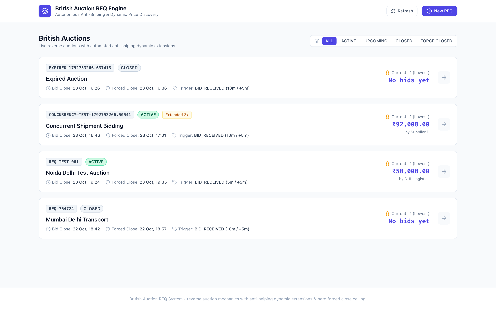
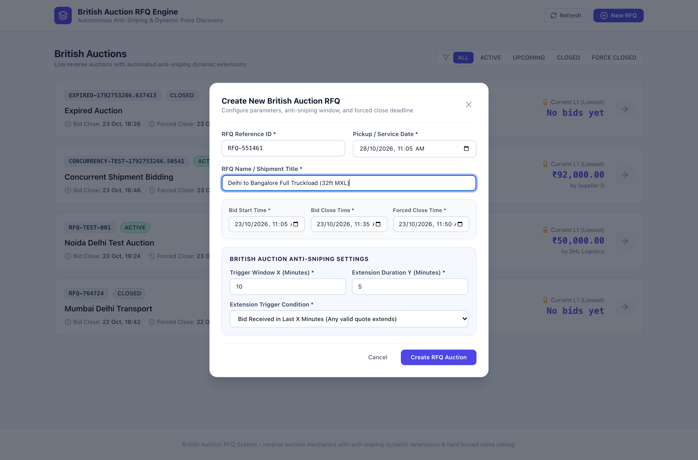
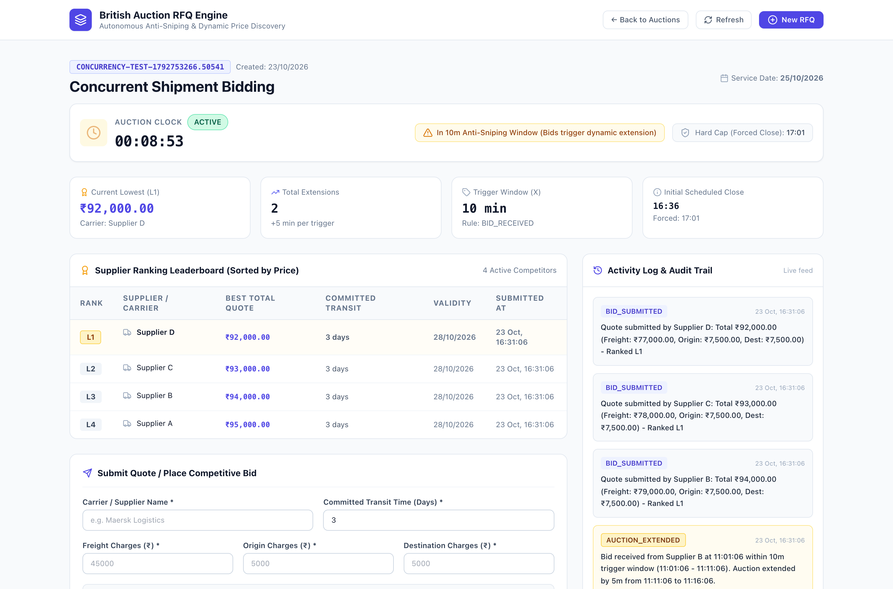
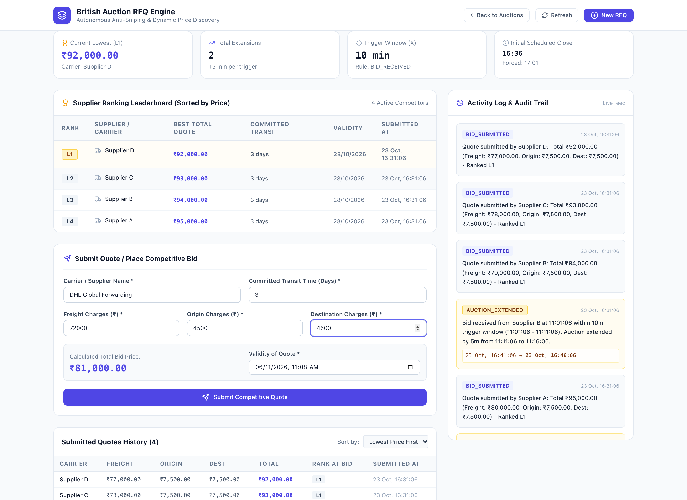
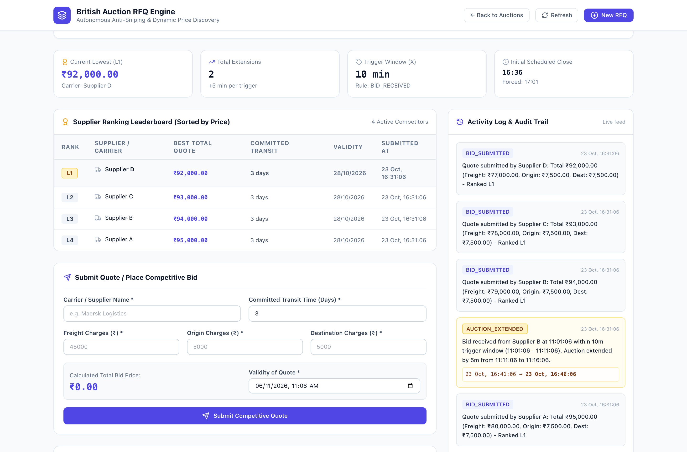
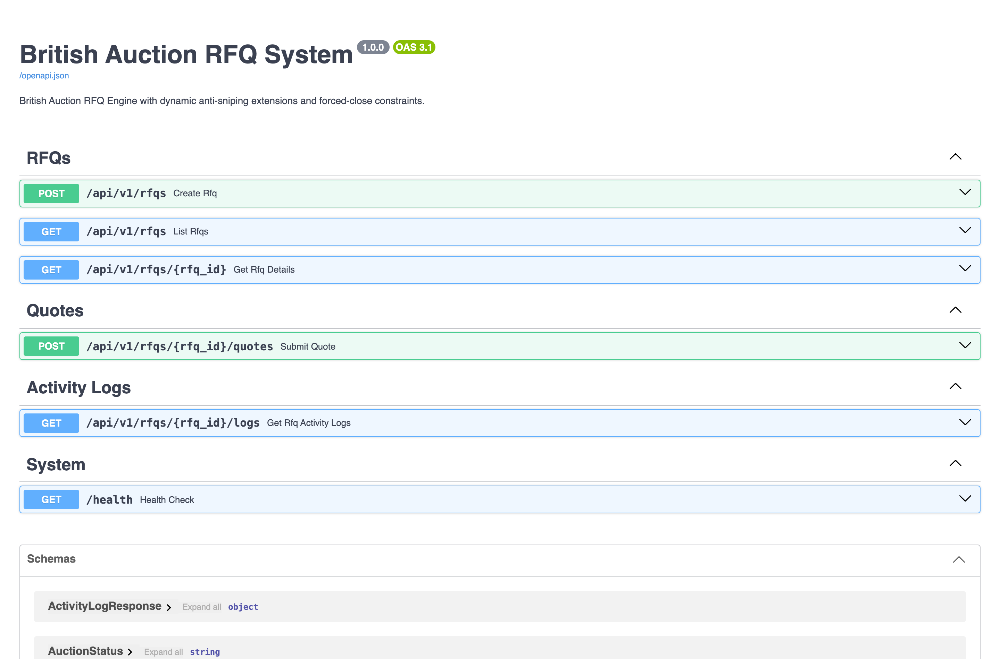

# Application Screenshots Guide

This directory contains actual high-resolution screenshots captured directly from the live British Auction RFQ System in the browser.

---

### 1. Auction Listing Page
Overview of all British Auctions with live status badges (`ACTIVE`, `CLOSED`, `FORCE_CLOSED`, `UPCOMING`), current lowest bids ($L1$), dynamic close times, forced close times, and extension counters.

---

### 2. Create RFQ Modal
Modal interface showing configuration of British Auction parameters: Reference ID, Service Date, Bid Start/Close/Forced Close times, $X$-minute Trigger Window, $Y$-minute Extension Duration, and Extension Trigger Condition.

---

### 3. Auction Details & Live Clock
Detailed view of an active British Auction featuring the real-time authoritative countdown clock, dynamic anti-sniping trigger window warning badge (`⚠️ In 10m Anti-Sniping Window`), Hard Cap Forced Close ceiling, and live parameter cards.

---

### 4. Supplier Ranking Leaderboard & Quote Submission
Real-time ranked competitor leaderboard ($L1, L2, L3, L4$) sorted by lowest bid price, alongside the interactive quote submission form with dynamic real-time price calculation and submitted quote history.

---

### 5. Activity Log & Immutable Audit Trail
Chronological audit trail documenting all quote submissions, rank changes, and auction extensions with explicit trigger reasons and previous/new close time ranges.

---

### 6. Interactive Swagger / OpenAPI Documentation
Interactive Swagger UI rendered at `http://localhost:8000/docs` exposing all RFQ, quote, and activity log REST API endpoints.

